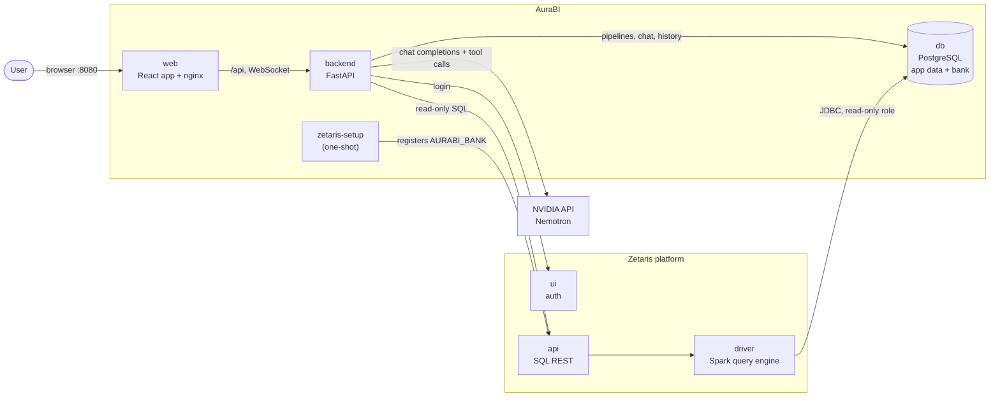
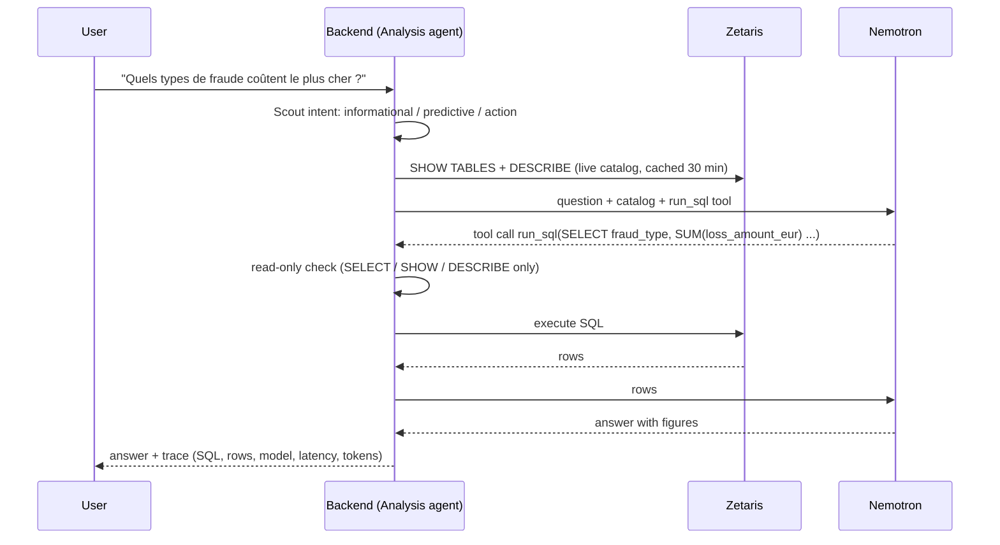
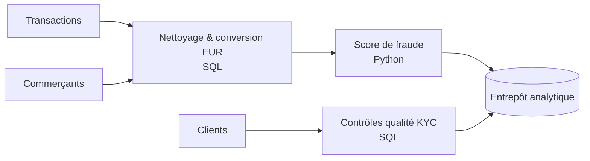

# AuraBI — Application guide

This guide explains what AuraBI is, how it is built, and how to use every part of it.
To install and launch it, see the [main README](../README.md).

## Contents

1. [What AuraBI does](#1-what-aurabi-does)
2. [Architecture](#2-architecture)
3. [How a question is answered](#3-how-a-question-is-answered)
4. [Tour of the screens](#4-tour-of-the-screens)
5. [The AI agents](#5-the-ai-agents)
6. [Governance: the Guardian](#6-governance-the-guardian)
7. [Zetaris integration](#7-zetaris-integration)
8. [The demo bank](#8-the-demo-bank)
9. [REST API](#9-rest-api)
10. [Configuration](#10-configuration)
11. [Development](#11-development)
12. [Current limits](#12-current-limits)

---

## 1. What AuraBI does

Banks need data pipelines — ingest transactions, clean them, detect fraud, feed a warehouse —
and analysts need answers from that data without writing SQL. AuraBI combines both:

- **A visual pipeline designer.** Sources, transformations (SQL or Python) and destinations
  are nodes on a canvas, connected by data flows. Every change is versioned and can be
  rolled back.
- **An AI data analyst.** Ask a question in natural language; the agent (NVIDIA Nemotron)
  writes SQL, runs it on **Zetaris**, reads the result and answers with the figures and the
  query it used. It never states a number that did not come from the data.
- **Governance built in.** The Guardian detects personal data (RGPD/GDPR), blocks sensitive
  operations until a human approves them, and only read-only SQL can reach the data.
- **Insights.** A dashboard of KPIs and charts, every figure computed live through Zetaris.

## 2. Architecture



| Service | Technology | Role |
|---|---|---|
| `web` | React 19, Vite, React Flow, Zustand, Tailwind; served by nginx | User interface; nginx also proxies `/api` and the WebSocket to the backend |
| `backend` | Python 3.12, FastAPI, SQLAlchemy (async), Alembic | Pipelines, agents, Guardian, analysis, insights, history |
| `db` | PostgreSQL 16 | Application data (pipelines, chat, runs…) and the demo bank (schema `bank`) |
| `zetaris-setup` | backend image, one-shot | Registers the bank database in Zetaris as `AURABI_BANK`, verifies it, exits |
| `demo-seed` | backend image, one-shot | Creates the demo pipeline and a first AI conversation on an empty install |
| Zetaris (`postgres`, `driver`, `api`, `ui`, `bootstrap`) | Zetaris Lightning platform | Data virtualisation: runs SQL across registered sources |
| Nemotron | `nvidia/nemotron-3.5-lightning-30b-a3b` on the NVIDIA API | Language model: understanding, SQL writing, explanations |

Startup order is enforced by Docker Compose health checks:
`db` → Zetaris `ui` → `zetaris-setup` → `backend` → `web` and `demo-seed`.

## 3. How a question is answered



Details that make the answers trustworthy:

- **Facts only from Zetaris.** The system prompt forbids figures not returned by a query.
  When no query ran, the response carries an explicit warning.
- **Live schema.** The agent is given the real tables and columns of `AURABI_BANK`, read
  from Zetaris at runtime — not a hard-coded description.
- **Self-correction.** If Zetaris rejects the SQL (syntax, unknown column), the engine's
  error message is sent back to the model, which fixes its query and tries again.
  Authentication or network failures are reported, never retried silently.
- **Action requests are stopped.** Requests to delete, modify, export or run something are
  classified as *action-oriented* and require Guardian approval instead of being executed.
- **Full trace.** Every answer stores the SQL executed, the first rows returned, the model,
  latency and token counts (`metadata.trace` of the chat message).

## 4. Tour of the screens

### Home — `/`
The agent entry page. Describe what you want to build or analyse, attach data files,
connect a database or a REST API. Links lead to the workspace and the project history.

### Workspace — `/workspace`
The main screen, in three panels:

| Panel | What you do there |
|---|---|
| **AI chat** (left) | Ask questions about the data; answers show the figures and are kept in the pipeline's history |
| **Canvas** (centre) | Add, move and connect nodes: **sources** (tables, files, APIs), **processing** (SQL or Python code), **data marts / warehouses** |
| **Inspector** (right) | Details of the selected node: columns, code editor, description, validation |

Changes are saved to the backend immediately and pushed to every open browser over a
WebSocket. Moving a node is layout only; adding, editing, connecting or deleting creates a
new **revision**.

### Insights — `/insights`
KPI cards and charts for the active pipeline, all computed by Zetaris on the bank data:
debit volume 2025 vs 2024, active customers, confirmed fraud losses, loan default rate,
monthly flows, spend by merchant category, fraud losses by type, branch performance, and
months whose fraud losses fall outside the expected band (mean ± 2σ). Each chart shows the
SQL and source table it came from. The search bar sends a question to the analysis agent
and turns the returned rows into a new chart.

### Plan — `/plan`
Describe a pipeline on the home page and the **planner agent** designs it: Nemotron reads
the live Zetaris catalog (tables, columns and the real values of code columns) and proposes
stages, reasoning, KPIs and architecture decisions. **Every KPI is measured on Zetaris**
before it is shown; a KPI whose SQL fails or does not return one number gets one repair
round, otherwise it is marked *Non vérifié*. Decisions are stored as questions and your
answers are saved. Planning takes one to three minutes; the page shows its progress.

### History — `/history`
Two timelines for the active pipeline:
- **Revisions** — every meaningful change with node and edge counts; **Restore** brings the
  graph back to any revision (node ids are preserved, and the restore is itself a revision).
- **Runs** — every pipeline run with its status, duration, steps and Guardian events.

## 5. The AI agents

| Agent | Where | What it does |
|---|---|---|
| **Analysis agent** (Master) | `backend/app/analysis/agent.py` | Answers chat and `/agent/query` questions with Nemotron + Zetaris tool calls |
| **Scout intent engine** | `backend/app/analysis/intent.py` | Classifies each request (informational / predictive / action) and its risk |
| **Guardian** | `backend/app/guardian/` | Detects personal data, decides which operations need human approval |
| **Question generator** | `backend/app/agents/question_generator.py` | Asks the user contextual questions when a run needs a decision |
| **Delegated tasks** | `backend/app/services/agent_task_service.py` | Profiler, Engineer, QA, Reporter… tasks created by the Master agent |
| **H-MEM memory** | `backend/app/meterless/memory.py` | Remembers previous answers and queries to give the model context |

## 6. Governance: the Guardian

- **Personal data detection.** E-mails, phone numbers, IBANs, card numbers, social security
  numbers and sensitive column names are detected in node data and masked in previews.
- **Human approval.** These operations are blocked until approved in the UI:
  dropping columns, exporting data, writing to a sink, exposing personal data.
- **Read-only data access.** The Zetaris client accepts only `SELECT`, `SHOW` and `DESCRIBE`,
  one statement at a time. Zetaris itself reads the bank through a PostgreSQL role that is
  read-only, and that role cannot see the answer key (`bank_meta`).
- **Pipeline runs** walk the graph in dependency order, pause on every approval or question,
  and record each step as an event (visible in History).

## 7. Zetaris integration

- At startup, `zetaris-setup` signs in to Zetaris, (re)creates the JDBC datasource
  **`AURABI_BANK`** on the bank schema with the read-only role, imports its 14 tables and
  views, and verifies with `SELECT count(*) FROM AURABI_BANK.customers`.
- The backend signs in with the Zetaris account and keeps the session token (valid 15
  minutes) fresh automatically; a static `ZETARIS_API_KEY` can be used instead (Zetaris Cloud).
- SQL goes to `POST /api/v1.0/sql-editor/sqls/run`; results are typed records
  (numbers as numbers) for the model and the charts.
- In the Zetaris console (<http://localhost:3000>) the same data is available as
  `AURABI_BANK.<table>`, next to the platform's own samples `NY_TAXI` and `TPCDS_DB`.

## 8. The demo bank

A retail/SME bank in Cameroon and France: 6,000 customers, 263,243 transactions, loans with
real repayment schedules, daily FX rates, labelled fraud cases, and deliberate data-quality
problems with their answer key. Generated deterministically: every install has exactly the
same data. Full description: **[database/README.md](../database/README.md)**.

The demo pipeline created at first start uses it:



## 9. REST API

Interactive documentation: <http://localhost:8000/docs>. Main routes (prefix `/api/v1`):

| Area | Routes |
|---|---|
| Pipelines | `GET/POST /pipelines`, `GET/PATCH/DELETE /pipelines/{id}` |
| Graph | `POST /pipelines/{id}/nodes`, `PATCH/DELETE …/nodes/{node_id}`, `POST …/edges`, `DELETE …/edges/{edge_id}` |
| Chat | `GET/POST /pipelines/{id}/chat` |
| Analysis | `POST /agent/query`, `GET /agent/traces/{request_id}` |
| Insights | `GET /pipelines/{id}/insights` |
| History | `GET …/revisions`, `GET …/revisions/{rev}`, `POST …/revisions/{rev}/rollback` |
| Runs | `GET/POST …/runs`, `GET …/runs/{run}`, `POST …/runs/{run}/resume`, `POST …/runs/{run}/answer` |
| Governance | `GET …/approvals`, `POST …/approvals/{id}/decide`, `GET …/questions`, `POST …/questions/{id}/answer` |
| Agents | `GET …/agent-tasks`, `POST …/agent-tasks/{id}/execute`, `POST …/plan/generate`, `POST …/plan/approve` |
| ETL | `POST …/etl/introspect`, `POST …/etl/execute`, `GET …/etl/results` |
| Realtime | `WS /ws/pipelines/{id}` |
| Health | `GET /health` |

## 10. Configuration

All settings live in `.env` (template: `.env.example`).

| Variable | Default | Meaning |
|---|---|---|
| `NVIDIA_API_KEY` | — | **Required.** NVIDIA API key |
| `NVIDIA_MODEL` | `nvidia/nemotron-3.5-lightning-30b-a3b` | Model used by the agents |
| `NVIDIA_BASE_URL` | `https://integrate.api.nvidia.com/v1` | OpenAI-compatible endpoint |
| `ZETARIS_PLATFORM_DIR` | `./zetaris-platform` | Where the Zetaris platform is unzipped |
| `ZETARIS_USERNAME` / `ZETARIS_PASSWORD` | the platform's admin account | Zetaris login |
| `ZETARIS_API_KEY` | empty | Static token instead of the login (Zetaris Cloud) |
| `ZETARIS_BANK_DATABASE` | `AURABI_BANK` | Name of the bank datasource in Zetaris |
| `AURABI_WEB_PORT` / `AURABI_API_PORT` / `AURABI_DB_PORT` | `8080` / `8000` / `5433` | Ports on this machine |

## 11. Development

```bash
# Backend tests (inside the backend image)
docker compose run --rm --no-deps -v ./backend:/app backend sh -c "pip install -q pytest pytest-asyncio && python -m pytest -q"

# Frontend type-check and tests
docker run --rm -v ./frontend:/src -w /src node:20-alpine sh -c "npm ci && npx tsc --noEmit && npx vitest run"

# Rebuild one service after a change
docker compose up -d --build backend
```

- Database migrations: `backend/alembic/versions/` — applied automatically at backend start.
- Demo data: `database/init/` — applied on the first start of an empty database
  (`docker compose down -v` to start again).

## 12. Current limits

- **Pipeline runs** walk through the graph for governance (personal-data checks, approvals,
  questions); they do not move data between systems.
- **ETL execute** turns an instruction into SQL with keyword rules and runs it read-only on
  the source table in PostgreSQL; the AI analysis goes through Zetaris.
- **Planning is slow** (one to three minutes): the design step keeps Nemotron's full
  reasoning, which is what keeps KPI names, units and currencies consistent.
- Personal-data detection recognises French phone formats, not yet Cameroonian ones.
- No user authentication: run AuraBI on your machine or a trusted network only.
